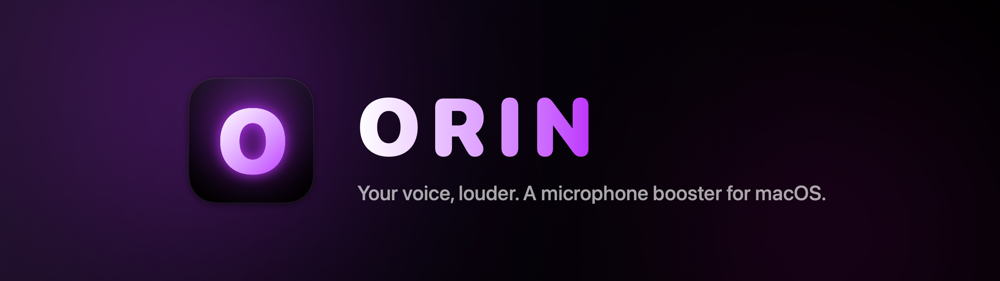
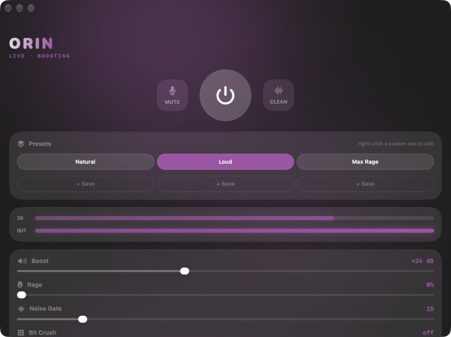

<p align="center">
  
</p>

<p align="center">
  <a href="https://github.com/hrxshxx/Orin/releases/latest"></a>
  
  
  <a href="https://discord.gg/QEykkuk6Gq"></a>
</p>

<p align="center">
  <b>Orin</b> makes your microphone louder in every app on your Mac.<br>
  Boost, shape and gate your voice, then use it in Discord, WhatsApp, Zoom, FaceTime, OBS and more.
</p>

---

<p align="center">
  
</p>

## Features

- **One-click boost.** Turn Orin on and your voice gets louder everywhere, up to +60 dB.
- **Rage mode.** Push past normal limits for that loud, punchy, distorted sound.
- **Noise gate.** Cuts quiet background sound such as fans and keyboard clicks when you're not talking.
- **Bit crush.** A lo-fi, radio-style effect.
- **6-band equalizer.** Shape bass, mids and treble from 100 Hz to 12 kHz.
- **Presets.** Natural, Loud and Max Rage are built in, and you can save three presets of your own.
- **Mute and Clean.** Silence your mic instantly, or switch to your natural voice without stopping.
- **Menu bar control.** Turn Orin on or off, mute, adjust the boost and switch presets from the menu bar.
- **Native Mac design.** Liquid Glass styling that follows your Mac's light/dark mode and accent colour.

## Install

### Option 1: Download

1. Download the **Orin .dmg** file from the [latest release](https://github.com/hrxshxx/Orin/releases/latest).
2. Open it and drag **Orin** into **Applications**.
3. Open Orin from Applications.

<p align="center">
  
</p>

### Option 2: Terminal

Paste this into Terminal:

```bash
curl -fsSL https://raw.githubusercontent.com/hrxshxx/Orin/main/install.sh | bash
```

This installs the latest Orin into Applications, installs the audio driver if it's missing, and opens the app.

### First launch

- **Audio driver.** Orin uses the free [BlackHole 2ch](https://existential.audio/blackhole/) audio driver to pass your voice to other apps. If it's missing, Orin installs it automatically. macOS asks for your password once.
- **Microphone access.** Click **Allow** when macOS asks. Orin can't hear you without it.
- **"Orin can't be opened" warning.** Right-click Orin in Applications and choose **Open**, then **Open** again. You only need to do this once.

## Use

1. Click the power button in Orin, or the **O** in your menu bar.
2. In Discord, WhatsApp, Zoom or any other app, set the **microphone / input device** to **BlackHole 2ch**.
3. Talk. Adjust **Boost**, pick a preset, or fine-tune the equalizer while you go.

> **Tip:** if you set Orin's *Send to* to your speakers, you'll hear yourself. Use headphones to avoid feedback.

## Uninstall

Quit Orin from the menu bar, then drag **Orin** from Applications to the Bin.

## Privacy

Orin processes your voice **entirely on your Mac**.

- No account, no sign-in, no tracking, no analytics, no ads.
- Your voice is never recorded, saved or uploaded.
- The only time Orin goes online is to download the BlackHole 2ch driver from its official website, and only if it isn't already installed.

Read the full [Privacy Policy](PRIVACY.md).

## License

Orin is free to use and free to share. You may distribute unmodified copies of Orin, including the official installer.
You may **not** modify, reverse-engineer, rebrand, sell, or recreate Orin or any part of it.
See [LICENSE](LICENSE) for the full terms.

## Community and support

Questions, ideas or bugs? Join the **[Orin Discord server](https://discord.gg/QEykkuk6Gq)**.

---

<p align="center">
  Developed by <b>Hrishi</b><br>
  © 2026 Hrishi. All rights reserved.
</p>
