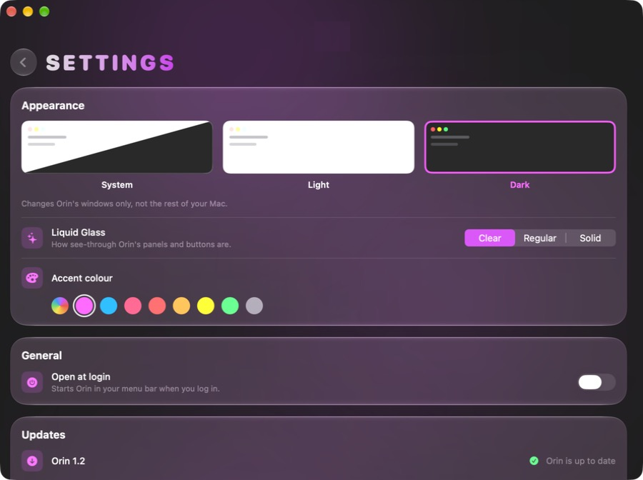
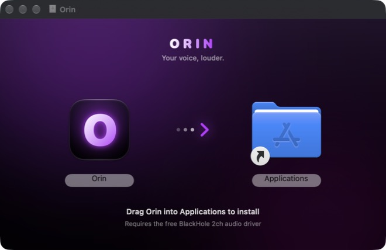

<p align="center">
  
</p>

<p align="center">
  <a href="https://github.com/hrxshxx/Orin/releases/latest"></a>
  
  
  <a href="https://discord.gg/QEykkuk6Gq"></a>
</p>

<p align="center">
  Orin makes your mic louder in every app on your Mac.<br>
  Turn it on, pick BlackHole 2ch as your mic in Discord, WhatsApp, Zoom or OBS, and people hear you properly.
</p>

<p align="center">
  
</p>

## What it does

### Make your voice louder

- Boosts your voice by up to +60 dB with one click.
- Rage adds extra gain on top of the boost, for a loud, distorted sound when you want it.
- Bit crush gives you a lo-fi, radio-style voice.
- A 6-band equalizer covers 100 Hz to 12 kHz, so you can add bass or clear up muddy audio.
- Green, yellow and red level meters show how loud you are, so you can see when you're about to distort.

### Get rid of background noise

- Denoise removes fan hum, traffic, keyboard clicks, coughs and heavy breathing. It only lets your actual voice through and goes silent between words, without cutting off the start of a sentence.
- It adjusts to your room by itself, so there's nothing to set up.
- The noise gate is still there if you want a simple, manual one.

### Change how you sound

- Gender Swap works out whether your voice is lower or higher and shifts it the other way, keeping the natural character of a real voice.
- Deep lowers your voice and gives it a bigger, more masculine sound.
- Both follow your voice as you talk, so you don't need to set your pitch.

### Stay in control

- Hear Me plays your voice back to you exactly as others hear it. Wear headphones when you use it.
- Mute silences your mic straight away. Clean switches the boost off without stopping Orin.
- Presets: Natural is your voice with no effects, and Loud and Max Rage are ready to go. You can save three of your own.
- Reset buttons put the voice controls and the equalizer back to zero.
- The O in your menu bar lets you turn Orin on or off, mute, change the boost, pick a voice and switch presets without opening the window.

### Make it yours

Click the gear in the top corner to open Settings.

- Pick light, dark or your Mac's appearance, just for Orin.
- Choose how much Liquid Glass you want: clear, regular or solid.
- Pick an accent colour, or keep your Mac's.
- Turn on Open at login so Orin starts in your menu bar.
- Check for updates. If a new version is out, one click downloads and installs it. If not, you'll see a green tick.
- Find the GitHub page and the Discord server.

<p align="center">
  
</p>

## Install

### Download

1. Download the Orin `.dmg` from the [latest release](https://github.com/hrxshxx/Orin/releases/latest).
2. Open it and drag Orin into Applications.
3. Open Orin from Applications.

<p align="center">
  
</p>

### Terminal

Paste this into Terminal:

```bash
curl -fsSL https://raw.githubusercontent.com/hrxshxx/Orin/main/install.sh | bash
```

It puts the latest Orin in Applications, installs the audio driver if you don't have it, and opens the app.

### The first time you open Orin

Orin sends your voice to other apps through [BlackHole 2ch](https://existential.audio/blackhole/), a free audio driver. If it isn't on your Mac yet, Orin installs it for you, and macOS asks for your password once.

macOS will also ask whether Orin can use the microphone. Click Allow, otherwise Orin can't hear you.

If macOS says Orin can't be opened, right-click Orin in Applications, choose Open, then click Open again. You only have to do this the first time.

## How to use it

1. Click the power button in Orin, or the O in your menu bar.
2. In Discord, WhatsApp, Zoom or whatever app you're using, set the microphone (sometimes called input device) to BlackHole 2ch.
3. Start talking. You can change the boost, pick a preset, turn on Denoise or try a different voice while you go.

> Want to check how you sound? Turn on Hear Me with headphones in. With speakers you'll get feedback.

## If something goes wrong

Orin shows a message at the top of its window with a short code like ORN-2 and what went wrong. Click Copy details and paste it in the [Chill w/ Hrishi](https://discord.gg/QEykkuk6Gq) Discord server, so the problem can be found and fixed. The details include your Orin and macOS versions and which devices you were using, nothing personal.

If you plug in headphones or your AirPods disconnect, Orin restarts its audio by itself.

## Uninstall

Quit Orin from the menu bar, then drag it from Applications to the Bin.

## Privacy

Your voice stays on your Mac. Orin doesn't record it, save it or upload it, and there's no account, tracking, analytics or ads.

Orin only goes online for two things: to check GitHub for a new version when you open Settings or click Check for updates (and download it if you click Update), and to download BlackHole 2ch from its official website if you don't already have it.

The details are in the [privacy policy](PRIVACY.md).

## License

Orin is free to use and free to share. You can pass on unmodified copies, including the official installer, but you can't modify, reverse-engineer, rebrand, sell or recreate Orin or any part of it. The full terms are in [LICENSE](LICENSE).

## Help and feedback

Got a question, an idea or a bug? Come say hi in the [Chill w/ Hrishi](https://discord.gg/QEykkuk6Gq) Discord server.

<br>

<p align="center">
  Developed by Hrishi<br>
  © 2026 Hrishi. All rights reserved.
</p>
